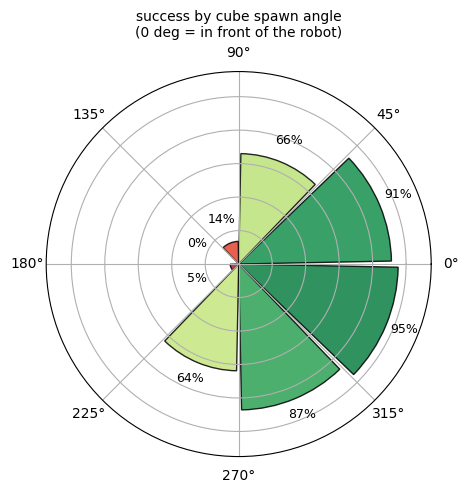
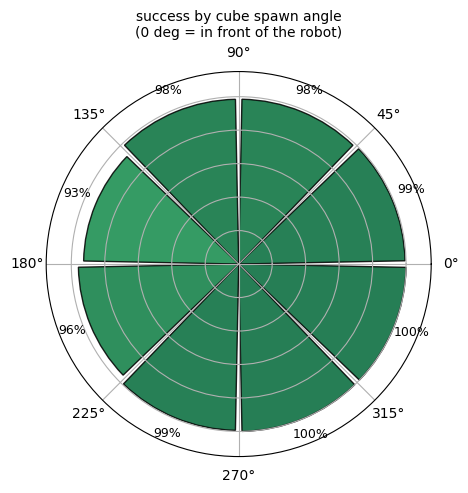
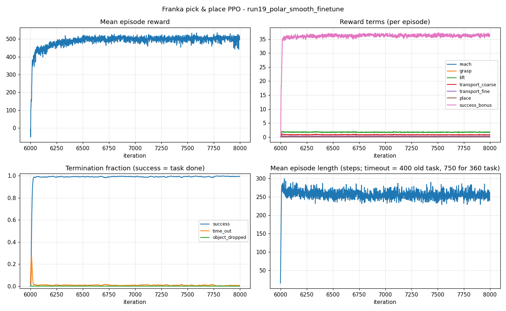
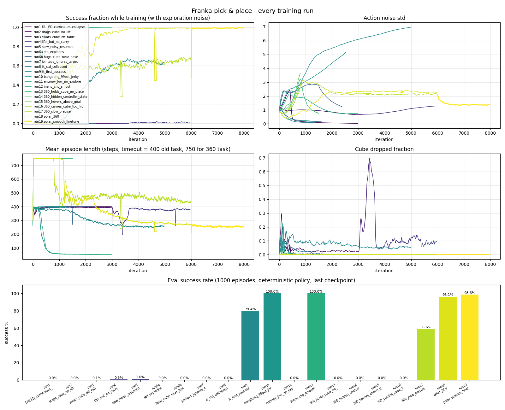
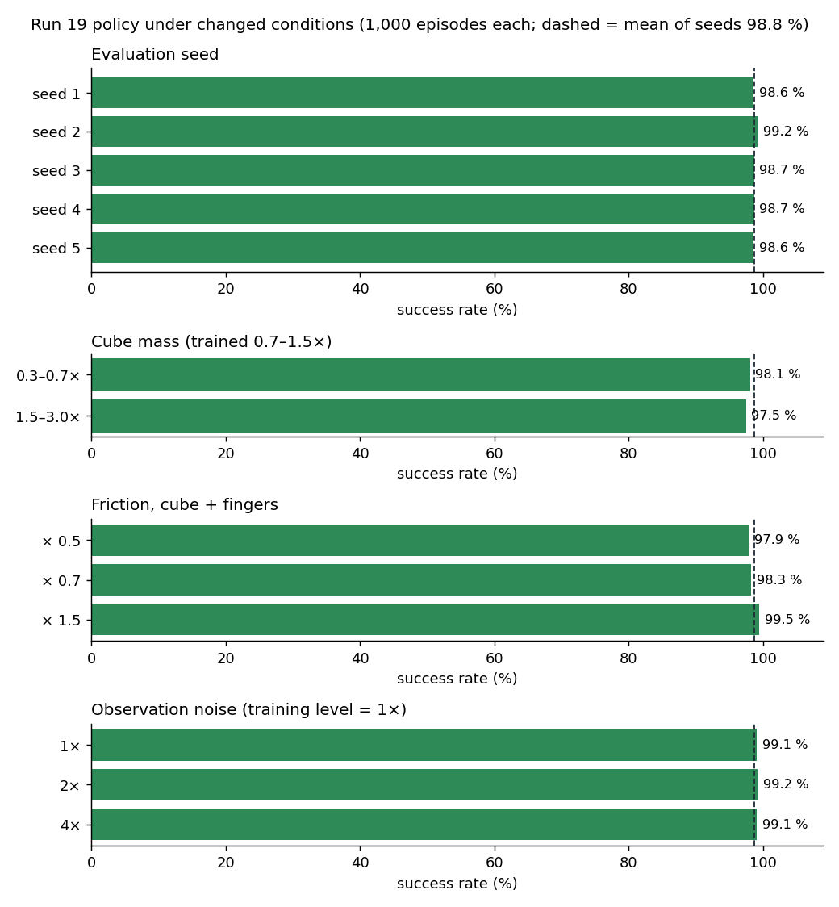

# Experiment report

> All experiments ran in simulation (Isaac Sim 6.0.1 / Isaac Lab 3.0), October – November 2026.
> Raw data: [`results/`](results) (evaluation output of run 17 and run 19, robustness summary).

## 1. Objectives
1. Train a Franka Panda with PPO to pick up a cube placed at random **all around the robot (±160°)** and place it on a random goal **within 1.5 cm**.
2. Keep the motion **slow and smooth** (hand ≤ 0.25 m/s) and never drop the cube.
3. See how the robot's **URDF** (joint limits) affects what the robot can learn.

## 2. Setup
| | |
|---|---|
| Computer | Windows 11, NVIDIA RTX 4070 Ti 12 GB |
| Software | Isaac Sim 6.0.1, Isaac Lab 3.0, rsl-rl-lib 5.0.1, PyTorch 2.10 |
| Robot | Franka Panda (URDF in [`hardware/mechanical/`](../hardware/mechanical/README.md)) |
| Scene, observations, actions, reward | see [`simulation/`](../simulation/README.md) |

## 3. Method
- **Training:** 4,096 robots train in parallel. Each run changes one thing (reward, action or a setting). We watch the result, find the problem, and fix it in the next run.
- **Testing** (`scripts/eval.py`): 1,000 episodes over the full ±160° area. Each episode ends as **success**, **cube dropped** or **time-out** (15 s).

| Metric | Meaning |
|---|---|
| Success rate | Share of episodes where the cube ends ≤ 1.5 cm from the goal and the hand lets go |
| Time to success | Mean time of the successful episodes |
| Hand acceleration | How smooth the motion is (lower = smoother) |

## 4. Results

### 4.1 Final model (run 19)
| Metric | Result |
|---|---|
| **Success** | **98.6 %** |
| Cube dropped | 0 % |
| Time to success | 5.05 s |
| Hand acceleration | 1.0 m/s² |
| Hand-written controller on the same task (`scripts/scripted_demo.py`) | 19.9 % |

 

*Success by cube angle around the robot (0° = in front). Left: run 17. Right: run 19.*

### 4.2 How we got there (20 runs in 5 steps)

| Step | Runs | What we did | Result | Lesson |
|---|---|---|---|---|
| 1 | 1–8 | Design the reward (reach → grasp → lift → carry → place) | Robot dragged, swatted or held the cube; 0 % | The robot finds every loophole in the reward |
| 2 | 9–12 | Command the hand (IK) instead of 7 joint angles; limit the commands | **100 %** on a small area in front of the robot | How the robot is commanded matters as much as the reward |
| 3 | 13–17 | Harder task: all around the robot, slow, 1.5 cm | 58.6 %; behind the robot 0–5 % | The arm hit its joint limits when reaching behind |
| 4 | 18–19 | Command the hand in polar coordinates (around joint 1) | **96.1 % → 98.6 %** in every direction | The command must match the robot's structure |
| 5 | 20 | Test on the robot rebuilt from the URDF file | 2.5 % → 97.6 % after a short retraining | The policy depends on the robot model |

### 4.3 Why run 17 failed behind the robot
Run 17 moved the hand in x/y/z. To reach a cube behind the robot, the straightest path passes close to the base, so the arm folded until **joints 2, 4 and 7 hit their URDF limits** and the hand never reached the cube.
Run 18 commands the hand as (towards/away, around the base, up/down), so joint 1 turns the arm around the base instead. Success behind the robot rose from 0–5 % to 93–96 %.

| | Run 17 (x/y/z) | Run 18 (polar) | **Run 19 (polar, fine-tuned)** |
|---|---|---|---|
| Success | 58.6 % | 96.1 % | **98.6 %** |
| Behind the robot (135–180°) | 0–5 % | 86–97 % | **93–96 %** |
| Time to success | 5.87 s | 5.59 s | **5.05 s** |

### 4.4 Robustness (run 19, 1,000 episodes per test)

| Test | Success |
|---|---|
| 5 different random seeds | 98.8 ± 0.3 % |
| Cube 1.5–3× heavier | 97.5 % |
| Half the friction | 97.9 % |
| 4× more sensor noise | 99.1 % |

### 4.5 Robot rebuilt directly from the URDF
Training used NVIDIA's ready-made robot file (`franka.usd`). We also built the robot directly from the URDF and tested the same policy:

| Robot | Success |
|---|---|
| Built from the URDF, as imported | 2.5 % |
| After fixing the import settings | 92.1 % |
| After 500 more training iterations on it (run 20, 14 min) | **97.6 %** |

The main difference: the link inertias in `franka.usd` are 10,000× smaller than in the URDF. Details in [`hardware/mechanical/`](../hardware/mechanical/README.md).

## 5. Discussion
1. **The reward must pay only for the goal.** Most early failures came from rewards that paid an in-between behaviour (dragging, holding) more than placing.
2. **The way the robot is commanded matters most.** The same reward went from 58.6 % to 96.1 % just by changing x/y/z hand commands to polar commands that suit the arm's joints.
3. **The URDF explains the remaining errors.** The weakest zone (behind the robot) is where joint 1 must turn close to its 166° limit.

## 6. Limitations
- Simulation only; not tested on a real robot.
- The policy often works with joints 4 and 6 near their limits, which a real robot may not allow.

## 7. Conclusion
Run 19 picks and places a cube all around the robot with **98.6 %** success, 1.5 cm accuracy and no drops, about 5× better than a hand-written controller. The URDF joint limits explain why the x/y/z version failed behind the robot and where the final model is still weakest.

## 8. Data files
| File | Content |
|---|---|
| `results/run19_polar_smooth_finetune_eval.txt` | Evaluation output of run 19 (1,000 episodes) |
| `results/run17_360_slow_precise_eval.txt` | Evaluation output of run 17 |
| `results/robustness/summary.csv` | All robustness and URDF-robot tests |
