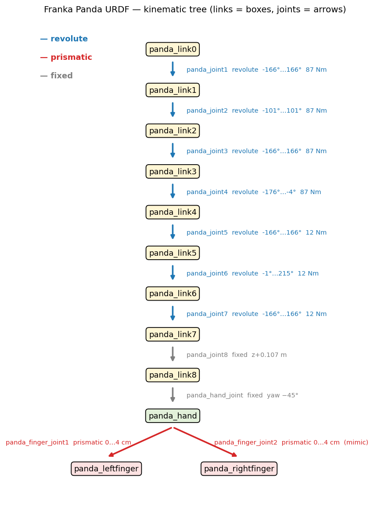
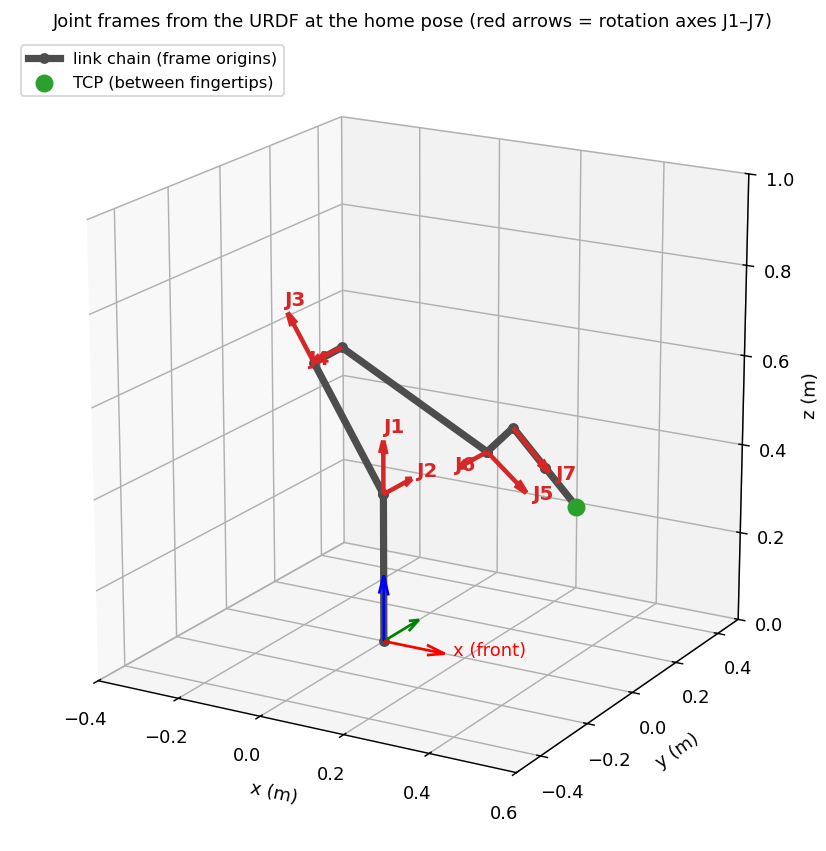
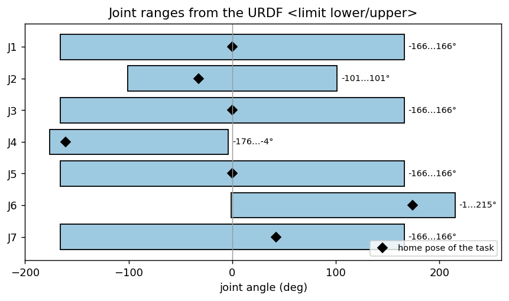
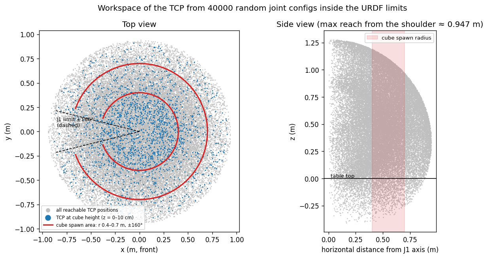
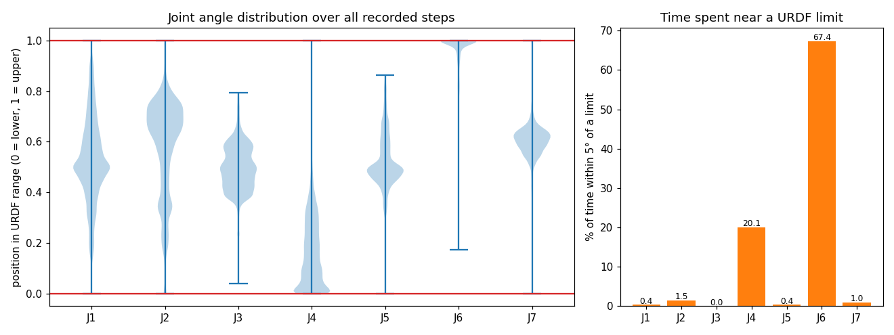

# Robot model: Franka Panda URDF

> The template uses this folder for CAD. This project builds no physical parts, so the folder holds the **mechanical model of the robot as a URDF** and its joint / link analysis.

| File | Content |
|---|---|
| [`urdf/panda_arm_hand.urdf`](urdf/panda_arm_hand.urdf) | Franka Panda arm + hand URDF (source: [`urdf/SOURCE.md`](urdf/SOURCE.md)) |
| [`analysis/joint_table.md`](analysis/joint_table.md) | All joints read from the URDF |
| [`analysis/link_table.md`](analysis/link_table.md) | All links: mass, inertia |
| [`analysis/dh_table.md`](analysis/dh_table.md) | DH table derived from the URDF |
| [`analysis/fk_check.txt`](analysis/fk_check.txt) | Forward kinematics check (URDF vs. DH) |
| [`analysis/sim_vs_urdf.md`](analysis/sim_vs_urdf.md) | Values the simulator uses vs. the URDF |
| [`analysis/joint_stats.md`](analysis/joint_stats.md) | How the trained robot uses each joint |

Made with `software/application/scripts/urdf_analysis.py` (no simulator needed) and `record_joints.py` (runs the trained policy).

---

## 1. What a URDF is

**URDF (Unified Robot Description Format)** is an XML file that describes the mechanical structure of a robot. Simulators such as Isaac Sim read it to build the robot.
A URDF only says what the robot **is**; it does not move the robot. Moving it is the job of the policy trained with RL.

A URDF has two kinds of elements.

**`<link>`: a rigid part of the robot**
```xml
<link name="panda_link0">
  <visual>    <geometry><mesh filename="package://franka_description/meshes/visual/link0.dae"/></geometry> </visual>
  <collision> <geometry><mesh filename="package://franka_description/meshes/collision/link0.stl"/></geometry> </collision>
  <inertial>
    <mass value="2.8142028896"/>
    <inertia ixx="0.0129886979" ixy="0.0" ixz="0.0" iyy="0.0165355284" iyz="0" izz="0.0203311636"/>
  </inertial>
</link>
```
| Tag | Meaning |
|---|---|
| `<visual>` | Shape you see (rendering only) |
| `<collision>` | Simpler shape used for contact (cube, table, the arm itself) |
| `<inertial>` | Mass and inertia, used by the physics engine |

**`<joint>`: the connection between two links**
```xml
<joint name="panda_joint1" type="revolute">
  <parent link="panda_link0"/>
  <child link="panda_link1"/>
  <origin rpy="0 0 0" xyz="0 0 0.333"/>
  <axis xyz="0 0 1"/>
  <limit effort="87" lower="-2.8973" upper="2.8973" velocity="2.1750"/>
</joint>
```
| Tag | Meaning |
|---|---|
| `type` | `revolute` (rotates), `prismatic` (slides) or `fixed` |
| `parent` / `child` | Which link is connected to which |
| `origin` | Position (m) and rotation (rad) of the joint relative to the parent link |
| `axis` | Axis the joint rotates or slides along |
| `limit` | Range (rad or m), max speed, max torque (Nm) or force (N) |

Multiplying the `origin` transforms and joint rotations from the base to the hand gives the **forward kinematics (FK)**: the hand position for given joint angles.

## 2. Structure of the Franka Panda

**12 links, 11 joints:** 7 revolute (arm), 2 prismatic (fingers; the right finger copies the left one with `<mimic>`), 2 fixed (flange and hand). Total mass **18.0 kg**.

 

*Left: link–joint tree. Right: joint frames and rotation axes (red) at the start pose.*

### Joint table
| Joint | Type | Parent → Child | Range | Max speed | Max torque / force |
|---|---|---|---|---|---|
| `panda_joint1` | revolute | link0 → link1 | −166° … 166° | 125 °/s | 87 Nm |
| `panda_joint2` | revolute | link1 → link2 | −101° … 101° | 125 °/s | 87 Nm |
| `panda_joint3` | revolute | link2 → link3 | −166° … 166° | 125 °/s | 87 Nm |
| `panda_joint4` | revolute | link3 → link4 | **−176° … −4°** | 125 °/s | 87 Nm |
| `panda_joint5` | revolute | link4 → link5 | −166° … 166° | 150 °/s | 12 Nm |
| `panda_joint6` | revolute | link5 → link6 | **−1° … 215°** | 150 °/s | 12 Nm |
| `panda_joint7` | revolute | link6 → link7 | −166° … 166° | 150 °/s | 12 Nm |
| `panda_joint8` | fixed | link7 → link8 | – | – | – |
| `panda_hand_joint` | fixed | link8 → hand | – | – | – |
| `panda_finger_joint1` | prismatic | hand → left finger | 0 … 4 cm | 0.2 m/s | 20 N |
| `panda_finger_joint2` | prismatic (mimic) | hand → right finger | 0 … 4 cm | 0.2 m/s | 20 N |



**Mechanical notes**
- Joints 1–4 (shoulder, elbow) carry 87 Nm, joints 5–7 (wrist) only 12 Nm: the joints near the base hold the weight of the whole arm, the wrist only the hand.
- Joints 4 and 6 have **one-sided ranges**: the elbow bends one way only.
- The fingers open 4 cm each (8 cm in total), so the cube is 4.1 cm.

### Link masses
| Link | link0 | link1 | link2 | link3 | link4 | link5 | link6 | link7 | hand | fingers | **Total** |
|---|---|---|---|---|---|---|---|---|---|---|---|
| Mass (kg) | 2.81 | 2.36 | 2.38 | 2.65 | 2.70 | 2.98 | 1.13 | 0.41 | 0.56 | 2 × 0.01 | **18.0** |

## 3. From the URDF to a DH table

Every arm joint `origin` of the Panda has the form `xyz = (x, y, z)`, `rpy = (roll, 0, 0)`, so the **modified DH (Craig)** parameters can be read off directly: `a = x`, `α = roll`, and `d` is the offset along the new z axis.

| i | a (m) | d (m) | α | θ |
|---|---|---|---|---|
| 1 | 0 | 0.333 | 0° | q1 |
| 2 | 0 | 0 | −90° | q2 |
| 3 | 0 | 0.316 | 90° | q3 |
| 4 | 0.0825 | 0 | 90° | q4 |
| 5 | −0.0825 | 0.384 | −90° | q5 |
| 6 | 0 | 0 | 90° | q6 |
| 7 | 0.088 | 0 | 90° | q7 |
| flange | 0 | 0.107 | 0° | 0 |

**Check:** for 2,000 random joint angle sets, FK from the URDF and FK from the DH table give the same hand position (difference ≤ 3.4×10⁻¹² m, i.e. only rounding). This matches the DH table that Franka publishes.

## 4. Workspace and the task area



Hand positions computed by FK for 40,000 random joint angle sets:
- Maximum reach from the shoulder ≈ **0.95 m**.
- The cube and goal are placed **0.40–0.70 m** from the base: close enough that the arm is never fully stretched, far enough from the base that the arm does not hit itself.
- Joint 1 turns only ±166°, so the area straight behind the robot cannot be reached. The task area stops at **±160°**.

## 5. URDF vs. the simulator

```
panda_arm_hand.urdf ──(URDF Importer)──► robot file (USD) ──(Isaac Lab)──► robot in the simulation
```

| Value | URDF | Simulator | |
|---|---|---|---|
| Joint ranges, speeds, torques | as in the joint table | identical | ✅ |
| Link masses | as in the mass table | identical | ✅ |
| Finger force | 20 N | 200 N | raised so the cube is held firmly |
| Joint motor gains (Kp / Kd) | **not in the URDF** | 400 / 80 | the simulator must add them |
| Gravity on the arm | – | off | the real Franka controller compensates gravity |
| Link inertia | URDF values | **10,000× smaller** in NVIDIA's `franka.usd` | see below |

**FK vs. the simulator:** joint angles recorded while the trained robot works were put into the URDF FK and compared with the hand position from the simulator: the difference is **at most 0.004 mm**. The URDF model matches the simulated robot.

**Robot rebuilt directly from the URDF:** training used NVIDIA's `franka.usd`, whose link inertias are 10,000× smaller than the URDF. On a robot imported directly from the URDF the trained policy first scored 2.5 %, 92.1 % after fixing the import settings, and **97.6 %** after 500 more training iterations on that robot (run 20). The dynamics in the robot file matter, not only the joint limits.

## 6. How the URDF values affect learning

### 6.1 Joint 1 limit → hardest area is behind the robot
The further behind the robot the cube is, the more joint 1 must turn. Near ±160° it needs almost its full 166°. This is where the final model is weakest (93–96 % success, compared with 98–100 % elsewhere).

### 6.2 Joints 4 and 6 work at their limits


| Joint | URDF range | Time within 5° of a limit |
|---|---|---|
| J1 | −166 … 166° | 0.4 % |
| J2 | −101 … 101° | 1.5 % |
| J3 | −166 … 166° | 0.0 % |
| **J4** | −176 … −4° | **20.1 %** |
| J5 | −166 … 166° | 0.4 % |
| **J6** | −1 … 215° | **67.4 %** |
| J7 | −166 … 166° | 1.0 % |

To pick a cube from the table with the hand pointing down, the arm bends the elbow (J4) fully and pushes the wrist (J6) to 215°. In simulation this is fine; **on a real robot** the Franka would stop near a joint limit, so this must be fixed first.

### 6.3 Joint limits made run 17 fail
Run 17 moved the hand in x/y/z. To reach behind the robot the arm folded until joints 2, 4 and 7 hit their limits, and success behind the robot was 0–5 %.
Run 18 moves the hand around the base with joint 1 instead: 96.1 %, then 98.6 % in run 19 ([experiments/](../../experiments/README.md)).

## 7. Conclusions
1. The URDF contains the kinematics (origin, axis) and dynamics (mass, inertia, limits) of the robot, but no motor gains; the simulator adds those.
2. The URDF converts directly to a DH table, and its FK matches the simulator within 0.004 mm.
3. The joint limits in the URDF directly shape the results: joint 1 limits the area behind the robot, and joints 4 and 6 are where the trained robot works at its limits.
