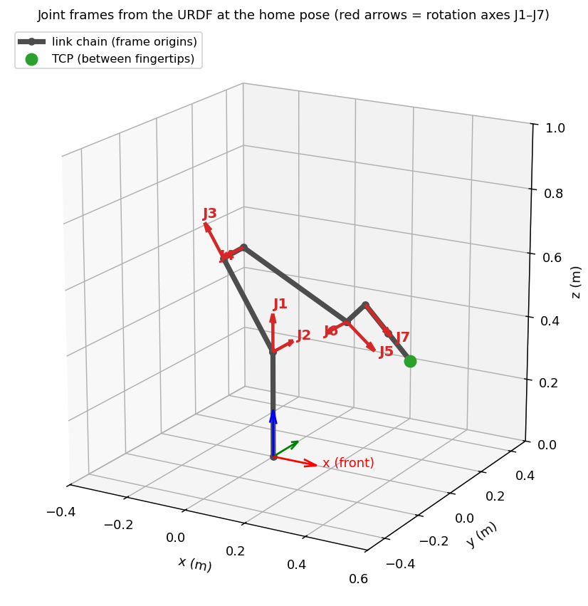

# Simulation

## Software and versions
| | |
|---|---|
| Simulator | NVIDIA Isaac Sim **6.0.1** (PhysX 5, GPU) |
| Framework | Isaac Lab **3.0** (manager-based RL environment) |
| RL library | rsl-rl-lib **5.0.1** (PPO) |
| Python / OS | Python 3.12 venv (`env_isaaclab`), Windows 11 |
| GPU | NVIDIA RTX 4070 Ti 12 GB |
| Task (gym id) | `Isaac-PickPlace-Franka-IK-Polar-360-v0` (training), `...-Play-v0` (testing) |

Code: [`software/application/source/franka_pick_place/`](../software/application/source/franka_pick_place)

## Scene


| Element | Value |
|---|---|
| Robot | Franka Panda + hand. Training used NVIDIA's `franka.usd` (converted from the Panda URDF; see [hardware/mechanical](../hardware/mechanical/README.md)). PD Kp 400 / Kd 80, gravity off on the arm |
| Table | Cylinder of radius 1 m with the robot at its centre; table top at z = 0 |
| Object | DexCube scaled 0.8 (≈ 4.1 cm), placed 0.40–0.70 m from the base at ±160°, random yaw, dropped from 0–5 cm |
| Goal | Same ring, at most 90° around the base from the cube and ≥ 10 cm away |
| Physics | dt = 0.01 s (100 Hz); decision every 2 steps (50 Hz); episode 15 s (750 steps) |
| Parallel robots | 4,096 (training), 1,000 (testing) |

### Assumptions and domain randomization
- Cube friction: static 0.5–1.2, dynamic 0.4–1.0. Fingers: 0.7–1.3 / 0.6–1.1.
- Cube mass randomised to 0.7–1.5× its default.
- Observation noise: joint angle ±0.005 rad, joint speed ±0.02 rad/s, cube/goal position ±5 mm (mimicking a camera error).
- Initial joints randomised ±0.1 rad around the home pose.
- The Franka controller is assumed to compensate gravity perfectly (gravity off on the arm). Latency and backlash are not modelled.

## MDP (what the policy sees and commands)

### Observation (50 values)
| Name | Size | Note |
|---|---|---|
| `joint_pos` | 9 | 7 joint angles + 2 fingers (relative to the home pose) |
| `joint_vel` | 9 | |
| `object_position` | 3 | Cube position in a **frame turned to face the hand around the base** (hand-azimuth frame) |
| `ee_position` | 3 | TCP position (same frame) |
| `target_pose` | 7 | Goal position + quaternion |
| `object_to_target` | 3 | Vector cube → goal |
| `actions` | 7 | Previous action |
| `arm_state` | 9 | Internal state of the hand velocity controller (the target the hand is following) |

In the hand-azimuth frame a cube behind the robot looks like a cube in front of it, so the policy can use one skill in every direction.

### Action (7 values, clipped to ±1)
| Index | Meaning | Scale |
|---|---|---|
| 0 | Radial (towards / away from the base) | 5 mm/step → **0.25 m/s** |
| 1 | Sideways around the joint 1 axis (turns both the position and the orientation of the hand around the base) | 5 mm/step |
| 2 | Up / down | 5 mm/step |
| 3–5 | Wrist rotation (roll, pitch, yaw) | 0.02 rad/step → 1 rad/s |
| 6 | Hand open/close (binary) | |

The action moves a "hand target", which is smoothed by an EMA (α = 0.3) and turned into joint angles by **differential IK (damped least squares)** using the Jacobian of the URDF chain.

### Reward (every term is multiplied by dt = 0.02)
| Term | Weight | Meaning |
|---|---|---|
| reach | 1 | Hand approaches the cube (kernel 1 − tanh(d/σ)) |
| grasp | 2 | Cube between the fingers and the hand commanded closed |
| lift | 15 | Cube lifted > 3 cm (counted as lifted until placed) |
| transport_coarse / fine | 16 / 15 | Cube approaches the goal (σ = 0.3 / 0.05 m, 3-D) |
| place | 10 | Cube within 1.5 cm, at rest, released |
| success_bonus | 50 (× dt → remaining steps + 50, once) | Finishing early pays more |
| object_dropped | −200 (once) | Cube falls off the table |
| action_l2, action_rate, joint_vel, rot_action | small, ramped up linearly over it 800–2000 | Smoothness |

### Termination
Success (placed) · cube below −5 cm · 15 s time-out · invalid physics state (NaN / out of range)

### Curriculum
1. The spawn angle starts at ±30° and widens to ±160° **only while training success > 60 %**.
2. Once the angle is fully open, the placing tolerance tightens from 3 cm to 1.5 cm.
3. Sectors that still fail are sampled more often (weight = 0.25 + 1 − sector success).

## PPO
| Parameter | Value |
|---|---|
| Network (actor / critic) | MLP 256-128-64, ELU |
| Steps per env per iteration | 24 (4,096 × 24 = 98,304 samples/it) |
| Learning rate | 1e-4 (adaptive, KL 0.01) |
| γ / λ | 0.99 / 0.95 |
| Clip / epochs / mini-batches | 0.2 / 5 / 4 |
| Entropy coefficient | 0.006 (run 18), 0.003 (run 19 fine-tune) |
| Iterations | 6,000 (run 18) + 2,000 (run 19) |

## Reproducing the results
```bat
cd software\application
REM train run 18 (about 3.3 h)
isaaclab.bat -p scripts\train.py --headless --num_envs 4096
REM fine-tune into run 19 (about 70 min)
isaaclab.bat -p scripts\train.py --headless --num_envs 4096 --resume <run18>\model_5999.pt --max_iterations 2000 --curriculum_state 160,1.5 --entropy_coef 0.003 --penalty_end action_l2=-0.1
REM evaluate on 1,000 episodes
isaaclab.bat -p scripts\eval.py --num_envs 1000 --headless --checkpoint ..\..\machine-skills\pick_place_policy\model_7998.pt
```
Seed 42. Logs and plots go to `software/application/logs/rsl_rl/franka_pick_place/<run>/`.
